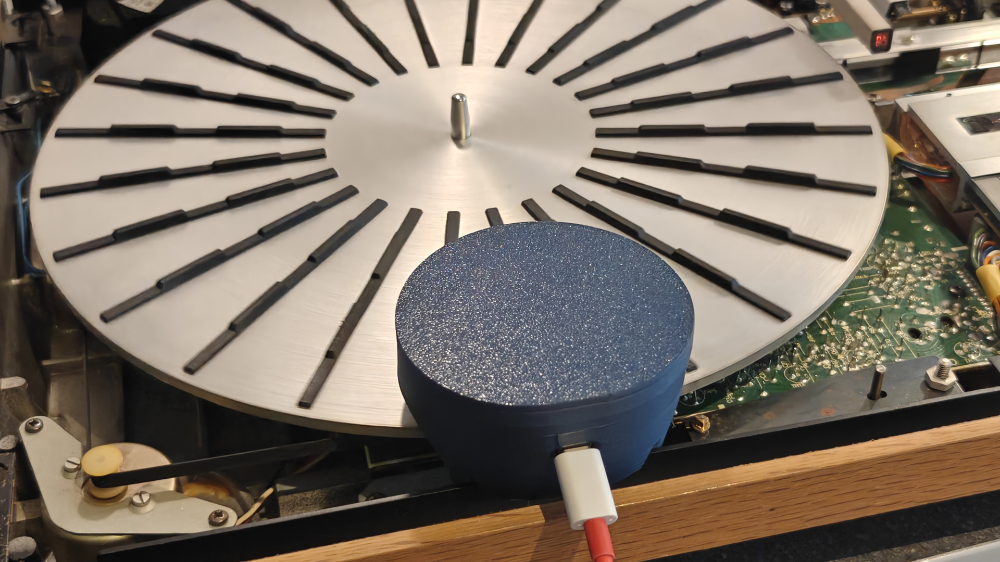
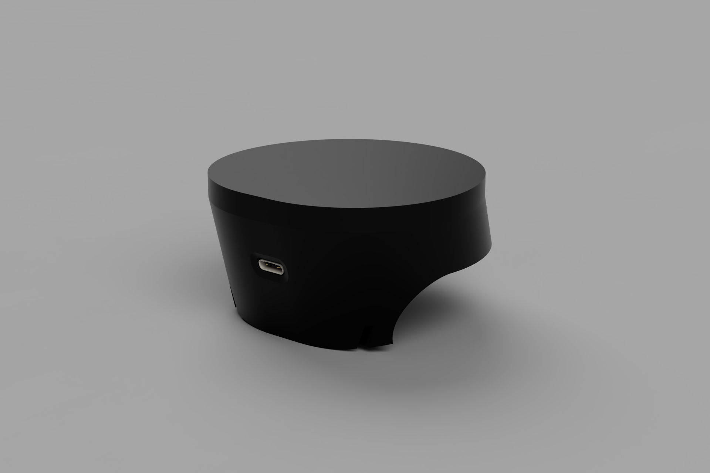
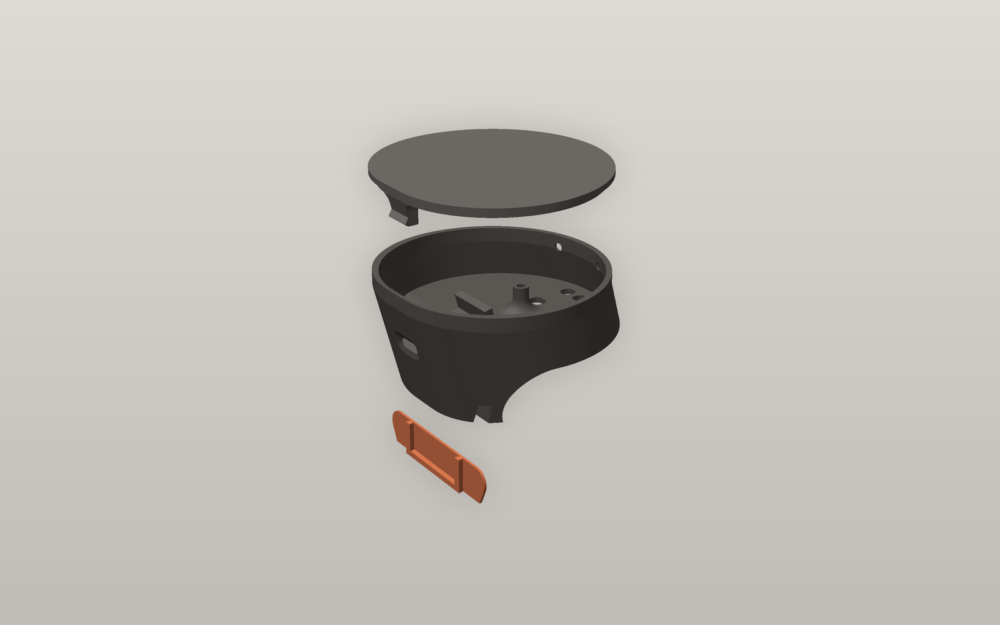
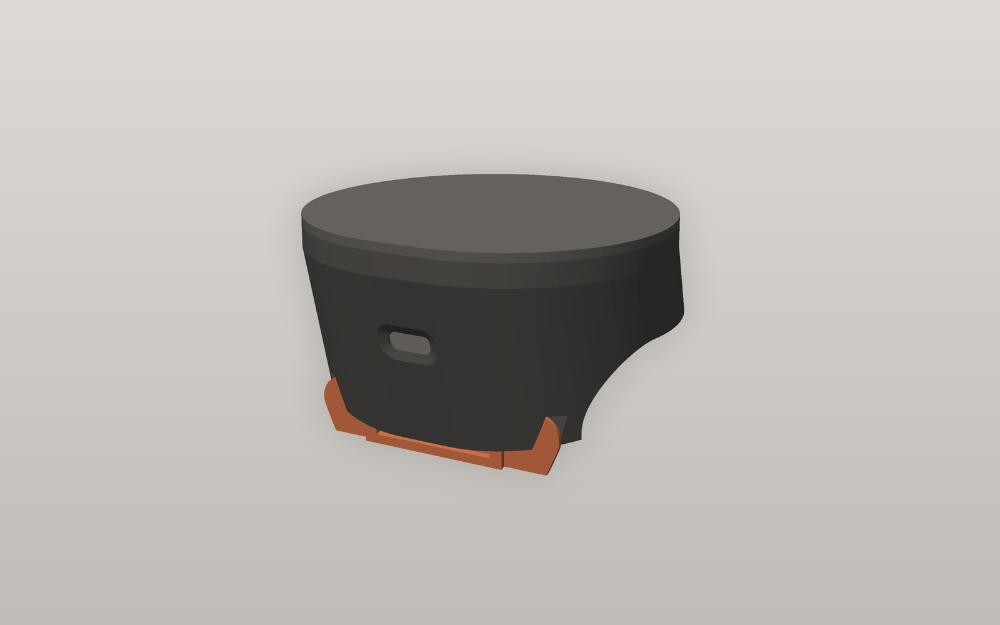
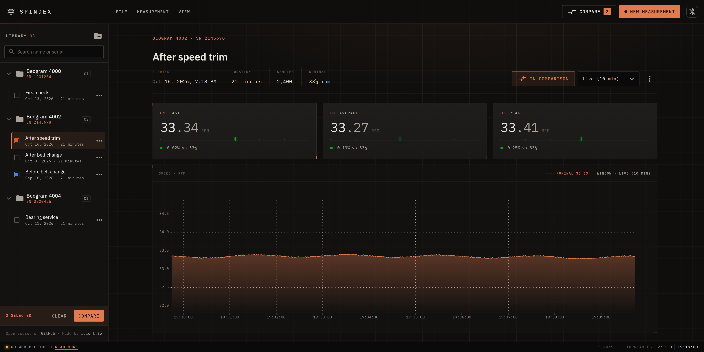
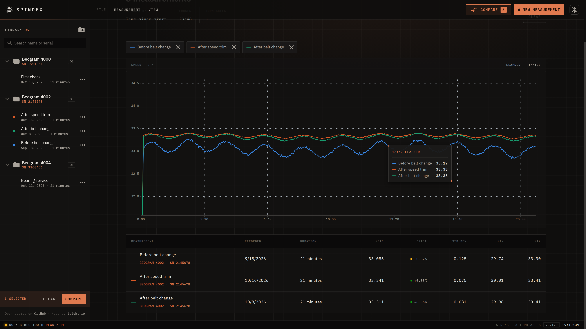

# SpinDex
SpinDex is a small RPM measurement tool for the Beogram 4000 series.
The main focus is to verify that the turntable is restored correctly and maintains the correct speed over an extended period.
The code is written to run on the M5Stack StampS3 (ESP32-S3) but could easily be ported to other microcontrollers and architectures.

This mono repository is divided into multiple sub-repositories, explained below:

### 3D Files (3d-files):
This folder contains the printable enclosure:
- `spindex_bottom.stl`: the base. It holds the electronics and sensor, and its curved jaw hooks onto the turntable chassis.
- `spindex_top.stl`: the lid.
- `spindex_spacer.stl`: an optional insert (about 2.8 mm thick) that clips into the base's jaw. The chassis width differs between production variants of the Beogram 4000, 4002 and 4004: print the base as-is for one width, and add the spacer to fit the other.

| Exploded: lid, base and spacer | Assembled with the spacer fitted |
|---|---|
|  |  |

---

### Web App (web-app)
This folder contains the web app. It connects to the controller over Bluetooth (Web Bluetooth) or a USB cable (Web Serial), with nothing to install, and records, organises and compares RPM measurements. It's hosted publicly, free to use, at **https://spindex.leicht.io/**.

Features:
- **Desktop-style layout**: a menu bar (File / Measurement / View), a library sidebar and a status bar showing the link (Bluetooth or USB) and the sensor's firmware version, a live recording readout, the app version and a clock.
- **Bluetooth or USB**: pick how to connect from the connection menu at the top right. Picking one drops the other, so readings are never recorded twice. The status bar warns when the sensor is connected but sends no readings.
- **Turntable folders**: measurements are grouped per turntable, identified by model and serial number (e.g. "Beogram 4002 · SN 2145678"). Pick or create the turntable when starting a measurement; typing an existing model/serial files it with the earlier runs. Search the library by name or serial.
- **Recording**: start/stop measurements, persisted locally in the browser (IndexedDB), so a page refresh or reconnect doesn't lose a running session. Automatic reconnect rides out a dropped Bluetooth link during an unattended run. Over USB, a cable pulled mid-session reconnects by itself when it's plugged back in, and a page reload during a recording picks the sensor back up without the picker. Otherwise an idle tab leaves the port alone for other tools.
- **Measurement view**: current/average/peak readouts with their deviation from the nominal 33⅓/45 RPM on a small gauge, colour-coded by how far off spec, plus a chart that zooms to the measured range and marks the nominal speed.
- **Chart time windows** (Live 10 min / 1h / 6h / 12h / 24h / All), auto-bucketed to a fixed point budget so even a 24h session stays smooth.
- **Gap-aware charting**: a disconnect or closed tab shows as a marked gap rather than a misleading flat or interpolated line.
- **Compare**: overlay up to eight measurements aligned by time since start (e.g. before/after a belt change), with a hover readout and a stats table: mean, drift from nominal, rev-to-rev standard deviation, min and max, ignoring spin-up and stopped readings.
- **Organise**: rename, move between folders, export as CSV, delete.
- **Connection help**: a dialog explains how to connect over Bluetooth and over USB on the current platform, with a table of which browsers support each. Browsing and comparing saved measurements works in any browser; only recording needs Web Bluetooth or Web Serial.
- **Changelog**: click the version in the status bar.
- Works from phone to desktop: below 900px the library becomes a drawer, and below 720px the menus fold into one overflow menu.
- Dark, instrument-style design after the leicht.io look: IBM Plex Sans / Plex Mono and a copper accent.

Browser support for recording:

| Browser | Platforms | Bluetooth (Web Bluetooth) | USB (Web Serial) |
|---|---|---|---|
| Google Chrome | Windows 10+, macOS, ChromeOS | ✓ | ✓ |
| Google Chrome | Linux | behind `chrome://flags/#enable-experimental-web-platform-features`, BlueZ 5.41+ | ✓ (needs access to `/dev/ttyACM*`, usually the `dialout` group; see the note below) |
| Google Chrome | Android 6+ | ✓ | only on some newer devices |
| Microsoft Edge | Windows, macOS | ✓ | ✓ |
| Firefox | Windows, macOS, Linux | ✕ | ✓ (151+) |
| Opera | Windows, macOS, Linux | ✕ | ✓ |
| Samsung Internet, Opera | Android | ✓ | ✕ |
| Bluefy | iPhone, iPad | ✓ (third-party app) | ✕ |
| Safari | all | ✕ | ✕ |

USB needs firmware built from this repository at or after USB support was added (see the µController section). Older firmware connects over USB but sends no readings. In the port picker the sensor is listed as *USB JTAG/serial debug unit*, a name fixed in the ESP32-S3 (see the µController section).

Chrome on Linux, in versions before Chromium's September 2026 fix, can drop the port the moment it opens it (the app says "the port was dropped right after opening it"). That happens after a pyserial-based tool (PlatformIO's upload or `pio device monitor`, esptool) has used the port, because those tools leave it with `VMIN=0` and Linux keeps that setting for the next program. Run `stty -F /dev/ttyACM0 min 1` and connect again. A PlatformIO upload does this for you (see below).

Measurements are stored per browser; export as CSV to move them elsewhere.

Development, from `web-app/`:
- `yarn start`: dev server (HTTPS, required for Web Bluetooth and Web Serial).
- `yarn build`: production build.
- `yarn test`: unit tests for the pure logic (chart bucketing/gap detection, CSV export, measurement stats, folder grouping, USB serial line parsing, changelog/version consistency).

Releases are listed in `web-app/app/core/changelog.ts`. Its newest entry must match the `version` in `web-app/package.json` (a unit test checks this), so bump both together.

---

### µController Source Code (controller-source)
This folder contains the source code for the microcontroller. The RPM edge-counting/calculation logic is split out into a hardware-free class (`src/logic/RpmCounter`) with its own unit tests, runnable on the host (no board needed) via `pio test -e native`.

Every 500 ms the firmware sends the current RPM two ways: as a Bluetooth notification, and as a line like `rpm:33.33` on the StampS3's own USB-C port. The web app reads those lines over Web Serial, and `pio device monitor` or the Arduino Serial Plotter can show them too.

The firmware's version is the web app's: `scripts/firmware_version.py` reads it from `web-app/package.json` at build time, so a release bumps one number (see the web app section) and the sensor reports the version of the app it shipped with. The web app reads it on connecting and shows it in the status bar. Over Bluetooth it's the Firmware Revision String (`0x2A26`) in the standard Device Information Service (`0x180A`). Over USB the app sends a `version` line and the firmware answers with a line like `version:2.3.0`, which it also prints on startup. You can type `version` into `pio device monitor` to check it. Firmware from before 2.3.0 doesn't report a version, and the app shows it as unknown. Firmware built without `web-app/package.json` next to it reports `unversioned`.

USB uses the ESP32-S3's built-in USB-Serial/JTAG unit (`ARDUINO_USB_CDC_ON_BOOT` in `platformio.ini`), which keeps uploads button-free. Its name, "USB JTAG/serial debug unit", is fixed in the chip. Only the USB-OTG controller (TinyUSB) could call the device "SpinDex", but on the pinned Arduino core its reboot-to-bootloader hangs the board, so every upload would need the G0 button.

After each upload, `scripts/restore_tty.py` sets the port back to `VMIN=1` on Linux so Chrome can read it (see the Linux note in the web app section). After using `pio device monitor`, run `stty -F /dev/ttyACM0 min 1` yourself.

A browser connected to the sensor holds its port, so choose **Disconnect** in the app (or close it) before uploading.

---

### Documentation (documentation)
This folder contains the [sensor pin setup and wiring diagram](documentation/pinSetup.md). The PCB schematics themselves live in `hardware/carrier-board`, below.

---

### Hardware (hardware/carrier-board)
This folder contains the custom carrier board PCB design (KiCad) that
piggybacks the M5Stack StampS3 module and the TCRT5000 IR sensor front end
on a single board. See its own [README](hardware/carrier-board/README.md)
for the schematic writeup, BOM, and what's left before fabrication.

---

Please note that this project is in progress and prone to change. The following tasks needs to be implemented before i consider the SpinDex finished.

- tests (started — see the web app's `yarn test` and the µController's `pio test -e native`; coverage is still thin, mostly the pure logic so far).
- custom-made PCB (in progress, see `hardware/carrier-board` — not yet routed or fabricated).

Feel free to develop further on the project and create PRs if, necessary. I would be happy to cooperate with others on the device.

More pictures and background: [SpinDex on leicht.io](https://leicht.io/restoration-services#spindex).
